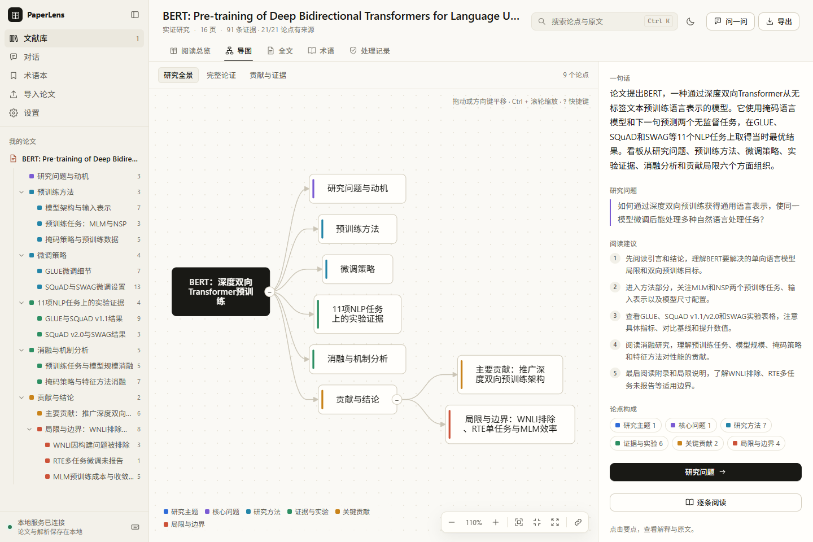

# PaperLens

PaperLens 是一个可以回到原文核查的论文阅读工作区。导入 PDF 后，你可以立即开始阅读原页。后台完成分析后，打开论点、公式或引用，即可对照对应的原文和页码。

[项目展示与 BERT 在线试读](https://justavisitorr.github.io/Paperlens/)



## 读第一篇论文

1. [下载源码](https://github.com/Justavisitorr/Paperlens/archive/refs/heads/main.zip)，完整解压。在 Windows 上双击 **启动 PaperLens.cmd**。首次启动会联网安装依赖，随后打开本机阅读页。
2. 打开 **设置 → 模型连接**，填写自己的模型服务地址、API 密钥和模型名称。选择支持 PDF 或页面图像输入的模型。新工作区预设 DeepSeek 连接，也可以自行配置其他服务。模型调用费用由提供密钥的账户承担。
3. 点击 **导入论文**，选择自己的 PDF，或试读仓库附带的 [BERT 论文](examples/bert.pdf)。上传后即可打开原 PDF。处理进度和可以重试的步骤会显示在任务列表中。
4. 打开 **阅读总览** 查看研究问题、方法和结论。点开一条论点的证据，核对引句和原页。在 **全文** 中可以对照译文、添加笔记，或从文末引用跳回正文。

## 阅读与引用

| 想做的事 | 在 PaperLens 中的操作 |
| --- | --- |
| 理清论文结构 | 在导图中展开研究问题、方法和结果，沿证据跳回论文 |
| 精读一段内容 | 在全文中查看原文、对照或译文，标记段落、术语和疑问 |
| 追踪引用 | 按作者、标题或编号筛选参考文献。打开原始来源，或展开引用树继续查找 |
| 写作时引用 | 在设置中选择复制格式。参考文献支持普通文本、BibTeX 条目和 LaTeX 引用命令 |
| 带走阅读结果 | 将已生成的报告导出为完整的单文件 HTML，离线查看正文、导图和证据。也可导出 Markdown |

引用树的覆盖取决于公开文献索引。审校记录、证据引句和原 PDF 均可用于复核模型的判断。

## 从源码运行

需要 Python 3.11 至 3.14。下面的命令适用于已安装 Python 的环境。已编译的阅读界面随源码提供。

```bash
git clone https://github.com/Justavisitorr/Paperlens.git
cd Paperlens
python -m venv .venv
```

在 Windows PowerShell 中运行 `.\.venv\Scripts\Activate.ps1`，在 Linux 或 macOS 中运行 `source .venv/bin/activate`，再执行以下命令。

```bash
python -m pip install -e .
python -m playwright install chromium
python -m paperlens serve
```

打开终端显示的地址，默认是 `http://127.0.0.1:8000`。命令行也可以直接生成离线报告。先将 [模型配置示例](.env.example) 复制为 `.env` 并填写自己的账户配置，然后运行：

```bash
python -m paperlens analyze examples/bert.pdf --output-dir outputs/bert
```

本机工作区将处理结果保存在 `outputs/`。AI 直读会把原始 PDF 或相应页面发送给你选择的模型服务。离线 HTML 可直接在浏览器打开，已有内容可以离线阅读。

## 多人自托管

独立服务支持邮箱验证码和可选的 GitHub 登录。每个账户有自己的文献、模型密钥和任务。可以先在本机用测试邮箱体验注册、上传和阅读，再配置自己的邮件服务与域名。[独立服务说明](docs/maintenance/standalone-accounts.md)

## 开发

后端与阅读流程在 `src/paperlens/`，React 阅读界面在 `frontend/`。后端测试使用临时目录和模拟模型，前端使用 Node.js 20.19+ 或 22.12+。

```bash
python -m pip install -e ".[dev]"
python -m pytest -q
cd frontend
npm ci
npm test
npm run build
```

前端构建结果为 `frontend/dist/index.html`。更新 Python 包内置界面时，将它复制到 `src/paperlens/assets/dashboard.html`。

## 许可

PaperLens 原创代码采用 MIT 许可，允许商业使用和修改，再分发时请保留版权与许可声明。[MIT 许可证](https://github.com/Justavisitorr/Paperlens/blob/main/LICENSE)

阅读界面所用的第三方组件和示例论文各有自己的许可。[第三方组件声明](src/paperlens/assets/THIRD_PARTY_NOTICES.txt) · [示例论文来源与署名](examples/README.md)
